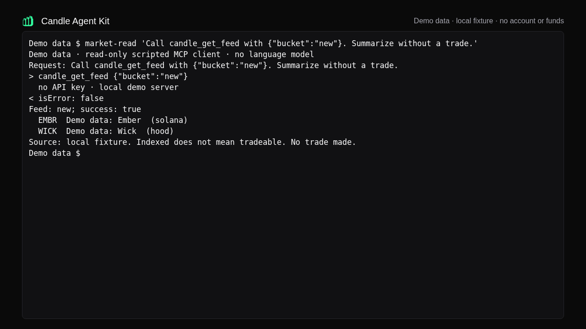
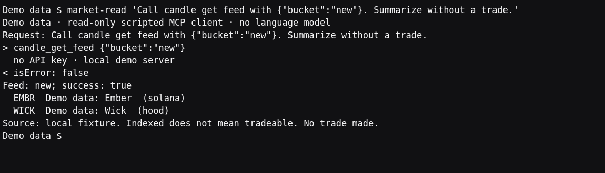
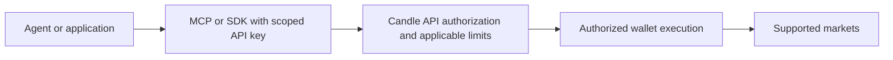
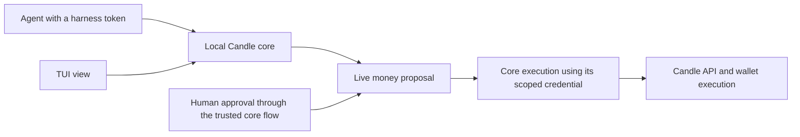

# Candle Agent Kit

Give your agent tools to read markets, trade, and launch tokens.

**Agent Kit** · [CLI](https://github.com/candledottv/cli) · TUI (in development)

[](https://www.npmjs.com/package/@candledottv/mcp)
[](https://docs.candle.tv/developers/mcp-server)
[](LICENSE)

Start with public market data. Add a scoped Candle API key when you are ready to use account or
trading features.

## Try a market read. No account required.

Add this to a local MCP client that starts servers over stdio and reads an `mcpServers` block. You
need Node 18 or later with `npx`. Where the block goes depends on your client: see
[Client configuration](https://docs.candle.tv/developers/mcp-server#client-configuration).

```json
{
  "mcpServers": {
    "candle": {
      "command": "npx",
      "args": ["--yes", "@candledottv/mcp"],
      "env": { "CANDLE_API_URL": "https://api.alpha.candle.tv" }
    }
  }
}
```

This configuration holds no key, so it can only read. `api.alpha.candle.tv` is Candle's live API,
despite the name.

Then ask your agent:

> Call `candle_get_feed` with `{"bucket":"new"}`. Summarize the results without making a trade.

**What you should see:** the agent calls `candle_get_feed` and gets `isError: false` with a list
of new tokens, which can be empty. You should not see an authentication error. The feed covers the
wider market, so some tokens it lists cannot be traded through Candle.

[](assets/recording.webm)

[Watch the keyless MCP call (about 17 seconds, playback controls). This is a scripted fixture client, with no language model.](assets/recording.webm)



<details>
<summary>Transcript of the recorded local session (Demo data)</summary>

```text
Demo data $ market-read 'Call candle_get_feed with {"bucket":"new"}. Summarize without a trade.'
Demo data · read-only scripted MCP client · no language model
Request: Call candle_get_feed with {"bucket":"new"}. Summarize without a trade.
> candle_get_feed {"bucket":"new"}
  no API key · local demo server
< isError: false
Feed: new; success: true
  EMBR  Demo data: Ember  (solana)
  WICK  Demo data: Wick  (hood)
Source: local fixture. Indexed does not mean tradeable. No trade made.
Demo data $
```

This scripted client calls the real MCP server against a local fixture, without a language model
or an API key. The tokens are Demo data, not market facts.

</details>

**If something else comes back:**

| You see | What it means |
| --- | --- |
| `"tokens":[]` | The call worked; nothing is in that bucket right now. Try `"bucket":"onfire"`. |
| `isError: true` with a connection error | The client could not reach the API. Check the network and `CANDLE_API_URL`. |
| No Candle tools at all | The client could not start the server. Check that `npx` runs from the client's own environment. |
| `MARKET_NOT_FOUND` from another read | Candle has not indexed that token. It is a coverage limit, not a fault, and not a reason to retry. |

## Choose how to connect

| Choice | When to use it | Next |
| --- | --- | --- |
| **MCP** | Your agent supports tools through MCP | [Client setup](https://docs.candle.tv/developers/mcp-server#client-configuration), or the [hosted server](https://docs.candle.tv/developers/mcp-server#hosted-server) for chat apps with nothing to install |
| **TypeScript SDK** | You are writing an application | [A read-only example](#read-only-sdk-example) below, then the [SDK guide](https://docs.candle.tv/developers/sdk) |
| **Skills** | Your agent harness should learn Candle workflows | [Install the skills](https://docs.candle.tv/developers/coding-agents#install-per-platform) |

Already using the [Candle CLI](https://github.com/candledottv/cli)? It has this MCP server built
in: `candle mcp --print-config` prints a client block that uses the key the CLI stores. You do not
need both.

### Read-only SDK example

```sh
npm install @candledottv/agent-sdk
```

```ts
import { CandleClient } from "@candledottv/agent-sdk"

// No apiKey: public reads only.
const candle = new CandleClient({ apiUrl: "https://api.alpha.candle.tv" })

const feed = await candle.getFeed("new")
for (const token of feed.tokens) {
  console.log(`${token.symbol ?? "?"}  ${token.name ?? ""}  (${token.chain})`)
}
```

## Enable account access

Reads need no key. Account reads, trading and launching need a Candle API key with the right
access level. Create one with the [Candle CLI](https://github.com/candledottv/cli) (`candle setup`)
or from your account. See [Access levels](https://docs.candle.tv/developers/agent-access#access-levels).

> **Agents and money.** A scoped API key can move funds within its permissions. Use the minimum
> permissions and limits required for the job. Local approval cards apply when tools run through
> the Candle core; a direct MCP or SDK connection can execute authorized writes. Revoke compromised
> credentials, and reconcile uncertain transaction outcomes before retrying. Limits and approvals
> do not prevent trading losses.

## Direct and core connections

**Direct connection.** Your agent uses MCP or the SDK with a scoped API key. The key authorizes
the capabilities it has been granted, and writes can execute without a local human prompt. MCP is
not an approval step.



**Core connection (preview).** Your agent runs `candle core mcp` from the
[Candle CLI](https://github.com/candledottv/cli), attached to the local Candle core. Reads and
paper flows work as usual. A live money write returns an approval card instead of executing, and
you approve it in the Candle TUI. Transfers are not offered to the agent. This route needs the CLI
and the Candle TUI, which is not released yet.



## Workflow examples

- **Read a market.** `candle_get_feed`, then `candle_get_market` for one token and
  `candle_token_forensics` for its launch history. No key.
- **Inspect your account.** With an `account:read` key: `candle_execution_status` for what this
  key may do, then `candle_get_portfolio` and `candle_get_profile_pnl`.
- **Review a proposal.** Through the core connection, an agent's buy comes back as an approval card
  showing the action, token, chain, wallet, amount and limits before anything runs.

When you are ready for a first live trade, follow the
[Agent quickstart](https://docs.candle.tv/developers/quickstart) and the `candle-first-live-trade`
skill. They start with the smallest trade and reconcile it before the next one.

## Packages

| Package | What it is | Docs |
| --- | --- | --- |
| [`@candledottv/mcp`](https://www.npmjs.com/package/@candledottv/mcp) | MCP server over stdio | [MCP server](https://docs.candle.tv/developers/mcp-server) |
| [`@candledottv/agent-sdk`](https://www.npmjs.com/package/@candledottv/agent-sdk) | TypeScript SDK | [SDK](https://docs.candle.tv/developers/sdk) |
| Skills | Workflow skills for agent harnesses, MIT | [Skills for coding agents](https://docs.candle.tv/developers/coding-agents) |

The full tool list is in the [MCP server reference](https://docs.candle.tv/developers/mcp-server#tools).
Release notes are on this repository's Releases page.

## More

- [AGENTS.md](AGENTS.md): the same material written for an agent, with retry rules first.
- [Error catalog](agents/error-catalog.json): every error code, whether it is retryable, and what to
  do.
- [Vulnerability disclosure](https://docs.candle.tv/rights-and-reporting/vulnerability-disclosure):
  report security issues privately, never in a public issue.
- This repository is generated from Candle's private monorepo, so pull requests cannot be merged
  here. Issues are read and welcome. See [CONTRIBUTING.md](CONTRIBUTING.md).
- MIT, see [LICENSE](LICENSE).
